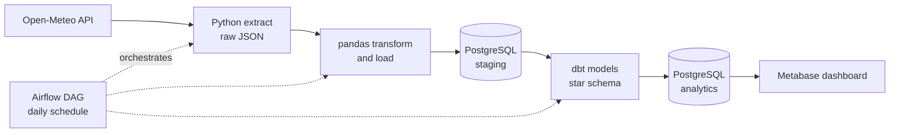

# Weather Data Engineering Pipeline

An end-to-end batch pipeline that ingests hourly weather data for 5 Indian cities, loads it into a PostgreSQL warehouse, models it as a star schema with dbt, tests data quality, schedules everything with Airflow, and visualizes it in Metabase. Everything runs locally with Docker.


## Architecture



## Tech stack
Python, pandas, SQLAlchemy, PostgreSQL, dbt, Apache Airflow, Metabase, Docker Compose, Git

## Data model
- `dim_city`: one row per city
- `dim_date`: one row per date
- `fact_weather_hourly`: one row per city per hour (temperature, humidity, precipitation, wind speed)

## Pipeline steps (Airflow DAG `weather_pipeline`)
1. `extract`: pulls 8 days of hourly data per city from the API into raw JSON
2. `transform_and_load`: cleans and standardizes the data with pandas and loads it into `staging.stg_weather_hourly`
3. `dbt_run`: builds the dimension and fact tables
4. `dbt_test`: runs 11 data quality tests (unique, not null, referential integrity)

## Run it locally
Prerequisites: Docker Desktop, Python 3.10+, Git.

```bash
git clone <your-repo-url>
cd weather-etl
docker compose build
docker compose up -d
```
- Airflow: http://localhost:8080 (trigger the `weather_pipeline` DAG)
- Metabase: http://localhost:3000 (connect to host `postgres`, database `weather_dw`, user `de_user`)

The credentials in this repo are for a local throwaway database only.

## Notes
- The load step replaces the staging table on each run, so the pipeline can be re-run safely.
- Weather data by [Open-Meteo.com](https://open-meteo.com/) (CC BY 4.0).